<div align="center">

# BareMacGUI

**Native macOS windows from Python with short `with` blocks. One dependency: PyObjC.**

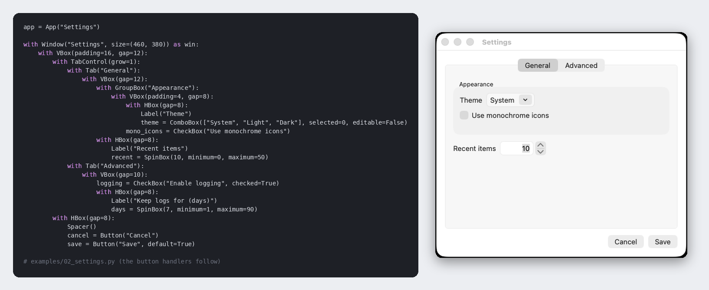

</div>

BareMacGUI is a thin Python layer for native macOS windows. Real AppKit controls through PyObjC, put together with short `with` blocks. No own drawing layer, no widget toolkit of its own: Dark Mode, system fonts and standard behaviour come from macOS.

The package and import name is `baremacgui`. The API shape follows BareWinGUI, the author's library for Windows.

> **Status: alpha (0.1.0a1).** The API may still change. The automated tests build every control on real macOS runners; clicking, typing and shortcuts are only partly checked by hand. See "What is verified" below.

```python
from baremacgui import App, Button, Label, VBox, Window, show_info

app = App("Hello")

with Window("Hello", size=(320, 160)) as win:
    with VBox(padding=16, gap=8):
        Label("Hello world")
        button = Button("Click me", default=True)

button.on_click(lambda: show_info("It works!", "Hello", parent=win))
app.run()
```

## Showcase

<p align="center">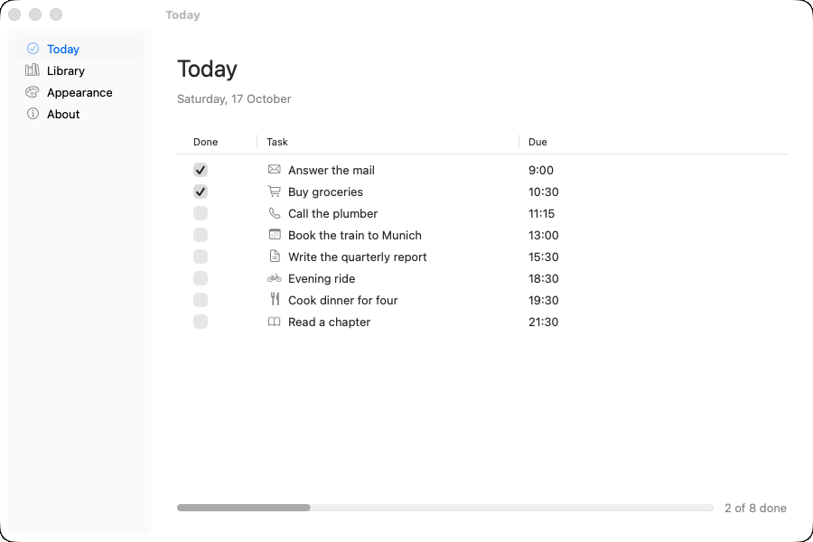</p>

This window is [`examples/16_showcase.py`](examples/16_showcase.py), 136 lines of Python. Nothing in it is drawn by the library: the sidebar, the table with its checkboxes and SF Symbols, the icon grid, the switch, the slider with tick marks, the segmented control, the color well and the calendar field are AppKit views, so the look, the fonts and Dark Mode are the system's own.

| Dark mode | Icon grid and drop zone | Settings-style rows |
|---|---|---|
| 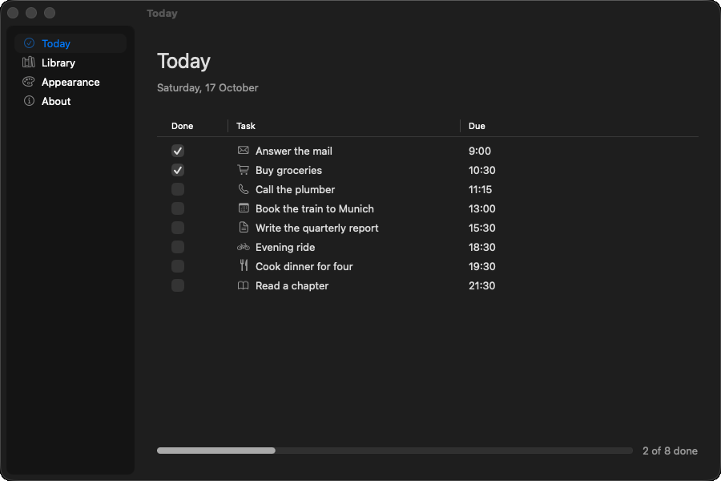 | 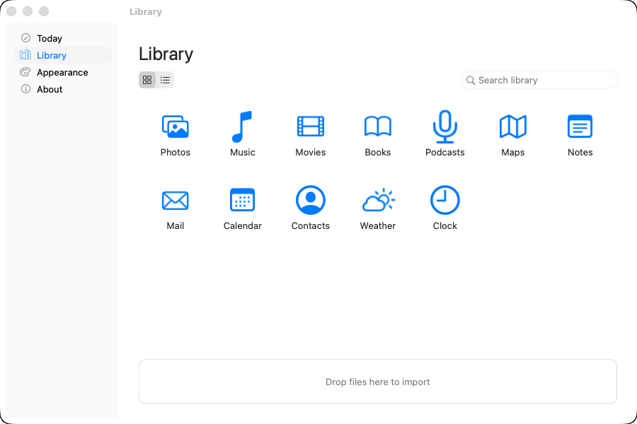 | 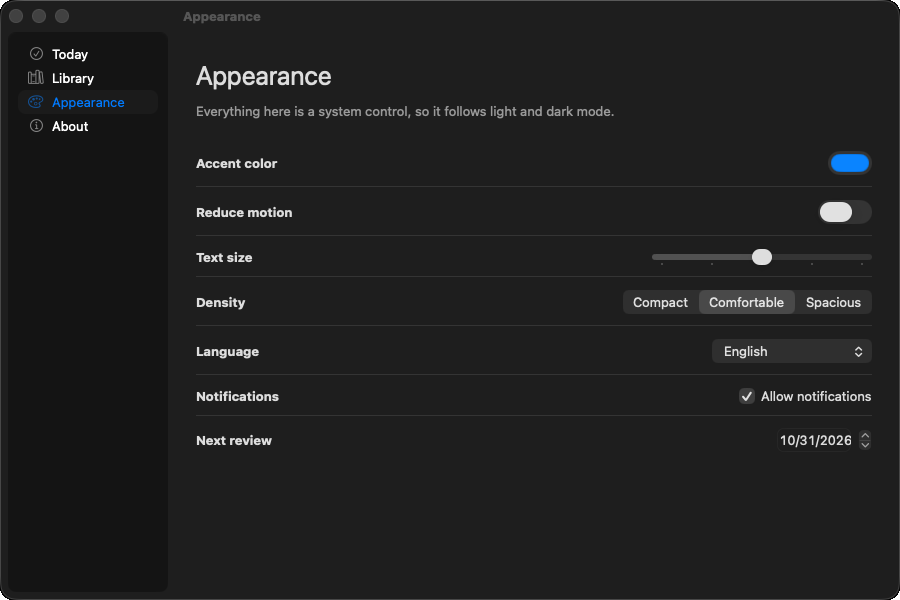 |

The screenshots come from GitHub's macOS runner, where the window is not in focus, so the accent color shows grey in places (a focused window uses your accent color). Run it yourself: `python examples/16_showcase.py`.

## Install

From a clone:

```
python3 -m venv .venv
source .venv/bin/activate
pip install -e ".[examples]"
python examples/00_hello.py
```

Needs macOS and Python 3.10 or newer. The one dependency is PyObjC (`pyobjc-framework-Cocoa`), installed automatically.

## What is included

| Area | Classes and functions |
| --- | --- |
| Windows | `App`, `Window` (styles `standard`, `unified`, `sidebar`; `on_close`, `on_resize`, `on_destroy`, `size`, `add_shortcut`, `default_button`, `cancel_button`, `show_modal`), `Sheet`, `Popover`, `Toolbar`, `Sidebar` / `Page` |
| Layout | `VBox`, `HBox`, `Spacer`; options `padding`, `gap`, `align`, `justify`, `grow`, `width`/`height`/`min_*`/`max_*` |
| Containers | `GroupBox`, `TabControl` / `Tab`, `SplitView` |
| Controls | `Label`, `TextBox` (single line, multi line, password), `ComboBox`, `DropDown`, `Button` (SF Symbols), `CheckBox`, `RadioGroup`, `SpinBox`, `Slider`, `ProgressBar`, `Image`, `Separator`, `SearchField`, `SegmentedControl`, `DatePicker`, `TimePicker`, `Switch` (NSSwitch), `ColorWell` (NSColorWell), `DropZone` (files dragged from Finder) |
| Lists | `ListBox`, `Table` (text cells; `editable=`, `sortable=True`), `IconGrid`, `Tree` |
| Menus | `MenuBar`, `Menu`, `MenuItem` (shortcuts, check marks), `MenuSeparator`, `ContextMenu` (`context_menu=` on any control) |
| Dialogs | `show_info`, `show_warning`, `show_error`, `ask_yes_no`, `ask_ok_cancel`, `input_box`, `open_file`, `save_file`, `pick_folder`, `choose_color`, `choose_font` (the first nine with `parent=` they become sheets; `then=` gets the answer) |
| Other | `StatusItem` (menu-bar item), `App(background=True)`, `Settings` (NSUserDefaults), `Window(autosave=...)`, `clipboard`, `Timer`, `Event`, `Custom(view)` for any AppKit view, errors `BareMacGUIError`, `PlatformError`, `LayoutError` |

The full list with signatures is in [`docs/REFERENCE.md`](docs/REFERENCE.md), generated from the docstrings.
The same reference, a guide and the examples are also a searchable web app: open `docs/site/index.html` in a browser (no server needed).

### Events

Handlers are plain functions without arguments; read the state from the controls.

```python
ok = Button("OK", on_click=save)      # as a constructor option
ok.on_click(save)                     # register another handler
@ok.on_click                          # as a decorator
def save(): ...
ok.on_click = save                    # assignment replaces all handlers
```

An exception inside a handler does not crash the app: it goes to `app.on_error` if you set one, otherwise it is printed to the terminal.

### Threads

Run slow work in a thread and hand the result back with `app.invoke(function, *args)`, or wait for a value with `app.call(function, ...)`. Controls are never touched from other threads.

### Window styles

- `Window(..., style="unified")`: Finder-like, a transparent title bar with `with Toolbar():` for buttons, `SegmentedControl`, `SearchField` (`examples/04_finder.py`).
- `Window(..., style="sidebar")`: System-Settings-like, a `Sidebar` with one `Page` per entry (`examples/05_settings_sidebar.py`).
- Escape hatch: every control exposes its view as `.ns`; `Custom(view)` puts any NSView you made into the layout.

### Menus

A Mac has one menu bar for the whole app, so a `MenuBar` belongs to a window: while that window is the key window, its menus sit between the standard App menu and the Edit and Window menus. Shortcuts are written `Cmd+S`, `Cmd+Shift+N`, `F5` (`Ctrl+S` also means Cmd, so code written for BareWinGUI keeps working). `&` access-key markers in labels are removed.

## Differences from BareWinGUI

Compared by reading the constructor signatures of both libraries (not by running the Windows one). Names that stay different on purpose, because the native thing is different:

- `Table`, `Tree`, `IconGrid`, `Sidebar`, `SplitView`, `Switch`, `ColorWell`, `DropZone`, `StatusItem`, `Settings` have no or different counterparts (BareWinGUI calls its table `ListView` and its tree `TreeView`).
- `DatePicker(calendar=True)` shows the calendar style of NSDatePicker; BareWinGUI has `long=` for the long date format.
- `Slider(vertical=True, ticks=n, snap=True)` counts tick marks (the native way) instead of BareWinGUI's `ticks` bool and `tick_frequency`; `RadioGroup` is one control with `items`, not single radio buttons.
- Dialogs take `parent=` and `then=` (macOS sheets). `choose_color` returns a hex string like `ColorWell` (BareWinGUI: an RGB tuple); `choose_color` and `choose_font` have no Cancel, because the system panels have none: they return what is selected when the user closes the panel.
- `Cmd` is the shortcut modifier; "Ctrl" in a shortcut string also means Cmd, so one string works on both systems.

## Accessibility

Every control takes `tooltip="..."` (the hint on hover) and `accessibility_label="..."` (what VoiceOver reads). Controls with visible text (a `Button("Save")`, a `CheckBox`) are read from their title by AppKit; give a label to everything without text of its own: icon buttons, `Image(..., description="Warning")`, `Slider`, `ProgressBar`, `SegmentedControl` with symbols, `SearchField`. The examples do this. Whether the labels read well with VoiceOver has not been checked by hand.

## Make it a double-clickable app

```
python -m baremacgui build my_script.py --name "My Tool" --icon icon.png
```

creates `My Tool.app` in the current folder: an `Info.plist`, the script in `Resources` and a small launcher that starts the Python that built it. The app has its own name and icon in Finder, and the script gets the same name and Dock icon through `App`. Options: `--dest`, `--identifier`, `--version`, `--background` (menu-bar app, no Dock icon), `--include` (extra files or folders next to the script). From code: `baremacgui.build_app(...)`.

What it is not: the bundle is not self-contained (it needs the Python and the packages it was built with, at the same place), it is not signed or notarized, and it will not run on another Mac. Signing, notarization and a self-contained bundle need tools outside this library (for example py2app, or Apple's codesign and notarytool).

## Screenshots

From GitHub's macOS runner (workflow "Screenshots", light appearance):

| | | |
| --- | --- | --- |
| 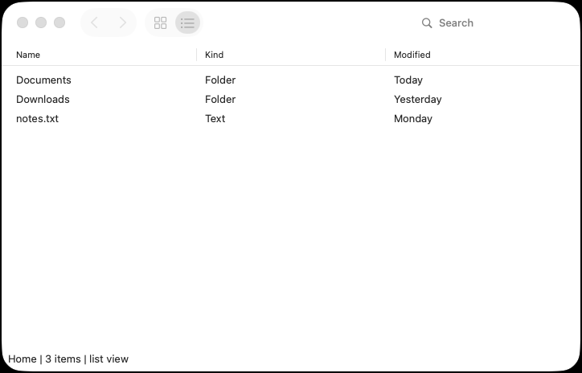 | 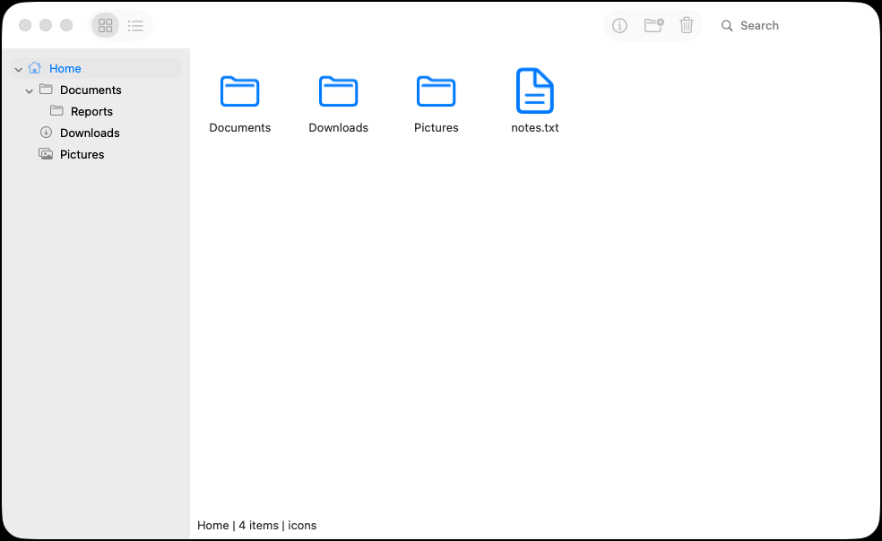 | 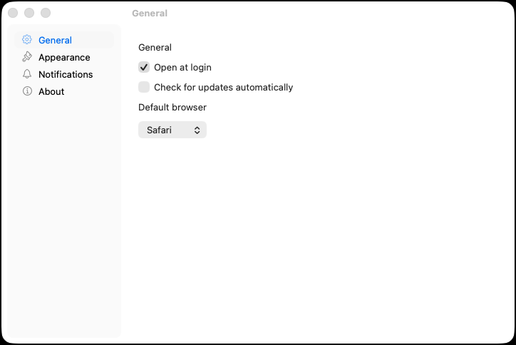 |
| 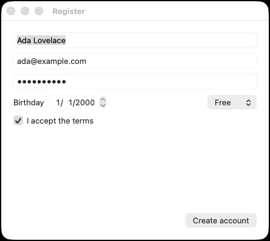 | 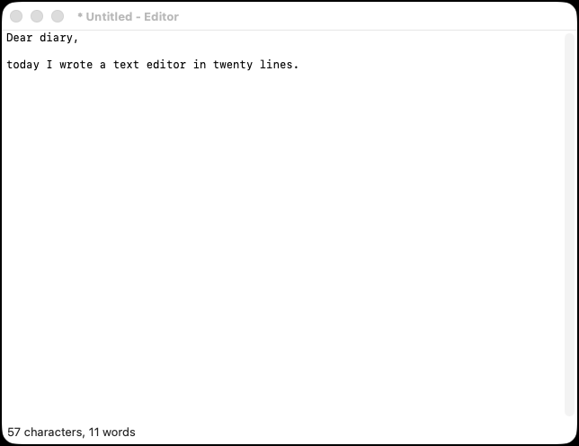 | 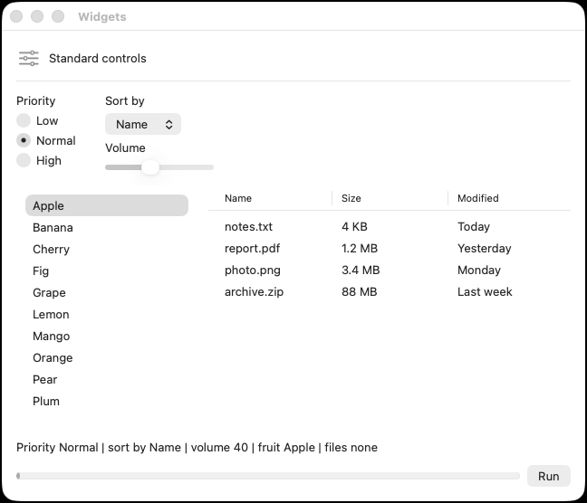 |

## Examples

Run them with `python examples/<file>.py`:

- `00_hello.py`: a label and a button
- `01_header_check.py`: security-header checker (a real small tool, worker thread)
- `02_settings.py`: tabs, group box, combo box, check boxes, spin box
- `03_widgets.py`: a tour of the standard controls
- `04_finder.py`: Finder-style window with toolbar and navigation
- `05_settings_sidebar.py`: sidebar window
- `06_everything.py`: file browser with toolbar, tree, table, icon grid, popover, sheet and sheet dialogs
- `07_editor.py`: text editor with menu bar, shortcuts, file dialogs
- `08_form.py`: registration form with live validation and a date picker
- `09_progress.py`: long task in a worker thread with progress bar, cancel and timer
- `10_tasks.py`: editable, sortable table
- `11_notes.py`: split view with list and editor, notes kept with `Settings`
- `12_menubar.py`: menu-bar clock without a Dock icon
- `13_drop.py`: drop files from Finder onto a `DropZone`
- `14_checklist.py`: table with a checkbox column and SF Symbols (`Table(kinds=...)`)
- `16_showcase.py`: the best-of window: sidebar, table with checkboxes and symbols, icon grid, switch, color well, tick-mark slider, calendar
- `15_windows.py`: several windows, each with its own menus; Cmd+N opens another one

`tests/test_examples_mac.py` builds every example on macOS CI and tests the helper functions they define.

## What is verified

Checked by hand on an Intel Mac (macOS 15.5) with Python 3.14 and PyObjC 12.2.2, in dark appearance (light appearance only with an early prototype):
- All four examples start and render: boxes, `Spacer`, `TextBox`, `ComboBox`, `Button`, `CheckBox`, `SpinBox`, `GroupBox`, `TabControl` (General tab), `RadioGroup`, `DropDown`, `Slider`, `ProgressBar` (driven from a worker thread via `App.invoke`), `Image` (SF Symbol), `Separator`, `ListBox`, `Table`, `HBox(align="stretch")`, `show_info`, `on_click`, `on_change`, `on_select` and `on_activate`.
- Example 03 also looked right in light appearance.
- `Window(style="sidebar")` with `Sidebar` and `Page` (example 05: sidebar with symbols, page switching, window title following the page, `on_change`) in dark appearance.
- `Window(style="unified")` with `Toolbar`, `SearchField`, `SegmentedControl` and icon `Button`s (example 04) in dark appearance; the view-based `Table` restyle and the navigation added to the example afterwards were not rechecked.
- Screenshots from GitHub's macOS runner (a newer macOS than the Mac above, light and dark; `tools/shoot.py`, workflow "Screenshots") show all examples, and in example 06 the icon view with selection, the tree, the popover, the new-folder sheet and the delete sheet. The scenarios call the handler functions and set controls from code; they do not simulate mouse clicks.
- The test suite passes on GitHub Actions for Ubuntu, macOS on Apple Silicon and macOS on Intel (`macos-latest`, `macos-15-intel`), Python 3.10 and 3.14. On the macOS runners the tests build every control and container, exercise properties and events by calling them from code, create menus, context menus, timers and pickers, and run each example up to `app.run()`. No mouse or keyboard input is simulated.
- The wheel builds and installs into a clean environment, and `import baremacgui` does not import AppKit (CI job `package`).
- Screenshots of examples 07 to 09 (editor, form, progress) from the macOS runner look right in light and dark appearance; the menu bar of the editor is not visible in them.

Not yet checked on real hardware:
- Clicking through example 06 by hand: the icon view, double-click navigation, the popover, the sheet and the delete dialog. They look right in screenshots from the GitHub macOS runner (see below), but real mouse input was not simulated there. The most fragile: the blocking sheet form (without `then`), the double-click on icons, and hiding/showing the table and icon grid in example 06.
- `Sidebar` details: dragging the divider, hiding it, the minimum window size, light appearance.
- Example 04 after the `Table` restyle: back/forward navigation, double-click into folders, search filter, light appearance.
- The Advanced tab, `ask_yes_no`, the file dialogs.
- The menu bar shortcuts (Cmd+C, Cmd+V, Cmd+A, Cmd+Q), custom `MenuItem` shortcuts, `Window.add_shortcut`, `default_button` (Return) and `cancel_button` (Escape).
- `ContextMenu` on right-click for `Table`, `IconGrid`, `Tree` and `TextBox`.
- `TextBox.on_change` while typing (single and multi line), and that setting `.text` from code does not fire it.
- `Window.on_close` veto with the red button, `Window.show_modal`, the menu bar switching between windows.
- `input_box`, `ask_ok_cancel`, the date and time pickers with the mouse, `Timer` while a menu is open.
- Editing a `Table` cell by double-click and Return/Tab/Escape behaviour, clicking a header to sort (CI only drives it from code), and that an edit in a sorted table does not re-sort until the next click.
- `StatusItem` and `App(background=True)`: the entry appears and updates, the menu works, no Dock icon, the app keeps running without windows. Example 12.
- `SplitView`, `StatusItem` and examples 11 and 12 are built and tested on the macOS runners (green CI); a screenshot of example 11 shows the divider moved from code. The menu-bar item itself is not visible in screenshots.
- `SplitView`: dragging the dividers by mouse, remembering them across a restart (`autosave=`), window resizing with `fixed=` panes.
- `Settings` across real app restarts (CI only checks that a second object sees the values), `Window(autosave=)` restoring the position after a real quit.
- `ColorWell` with the real color panel, `Switch` by mouse, `clipboard` pasting into other apps.
- `Table(kinds=...)`: CI toggles the checkbox with `performClick`; clicking it by mouse, and how the checkbox and symbol cells look in light and dark, are unchecked.
- `tooltip` and `accessibility_label` are set and read back on the real views (CI). How VoiceOver speaks them, and the tooltip appearing on hover, are unchecked.
- Several windows: CI checks which menu bar is installed when each window becomes key (own `MenuBar`, standard menus, sheets and modal windows leave it alone). Switching by really clicking between windows, and the list of windows in the Window menu, are unchecked.
- `.app` bundles: CI builds one, starts its launcher and checks that the script sees the app name, its folder and its icon. Double-clicking in Finder, the Finder icon, the name in the Dock, and `--background` (no Dock icon) are unchecked.
- `DropZone` with a real drag from Finder (CI feeds it a pasteboard with file URLs and calls the drag methods; the mouse drag itself, the highlight and the cursor are unchecked).
- `Table` and `Tree` `on_activate` ignoring double-clicks on the header or empty space (uses `clickedRow`).
- Light appearance for the other examples.
- Apple Silicon, other macOS versions, multiple displays.
- The CI workflow itself.

## Limits

- macOS only, standard AppKit controls only. No custom drawing, no rich text, no cell types other than text in tables.
- Needs PyObjC. "Bare" here means thin, not dependency-free.
- Dialogs without `parent` are application-modal. With `parent` and without `then`, the call waits through a nested modal loop (see the unverified list); `then=` is the dependable form.
- Menu labels are English.
- `App.run()` hands control to AppKit. When the last window closes the app terminates (so far the process ends there); put cleanup into `Window.on_destroy`, not after `app.run()`. Unverified.
- `choose_color` and `choose_font` run the shared system panels modally until they are closed; CI drives them with a timer that sets a value and closes the panel. Picking by mouse, and the look of the panels, are unchecked.
- Running a script from a terminal gives a plain Python process: the menu bar title and Dock icon are Python's. A packaged `.app` is a separate step.

## Development

Design, decisions and acceptance testing are by the author. Most of the code, tests and documentation were written by an AI (Claude, Anthropic) to the author's specification. Anything marked unverified above has not been run on a Mac yet.

```
pip install -e ".[test]"
python -m pytest
```

Off macOS only the pure-Python tests run; the control tests are skipped.

`tools/shoot.py` runs an example, drives it from code and takes screenshots; the manual GitHub workflow "Screenshots" does that on a macOS runner and publishes the images to the `ci-screenshots` branch.

## License

MIT, see `LICENSE`.
